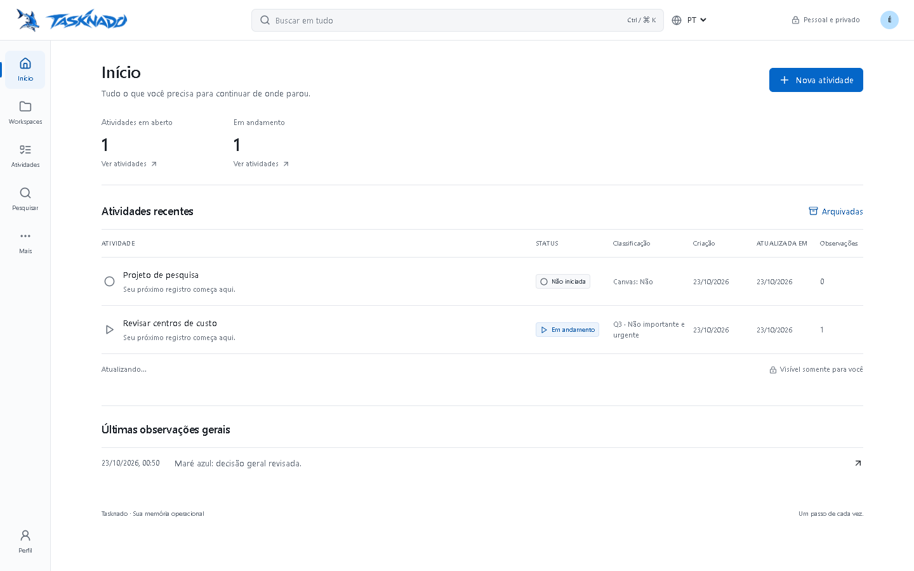
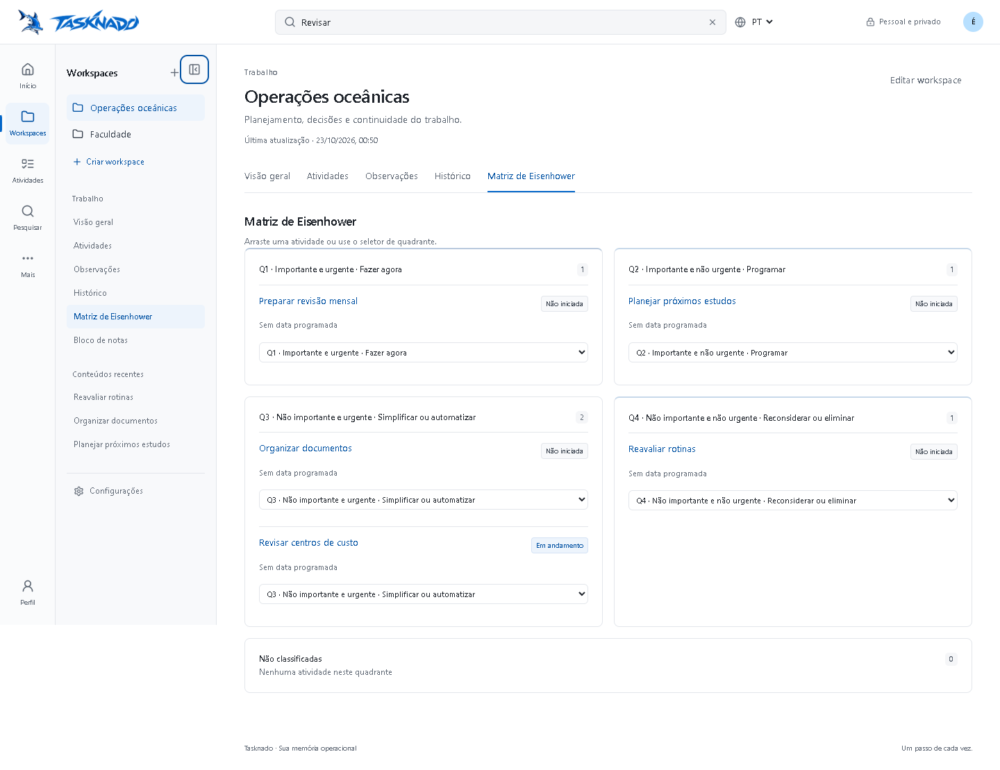

# TASKNADO — entrega Desktop Exclusive

Relatório A–J da evolução solicitada. Ambiente de validação: Windows, Microsoft Edge/Chromium e Supabase local real em `127.0.0.1:55431`. Os arquivos JSON em `test-results/` registram os horários das execuções. Este relatório não representa publicação ou validação de um banco remoto.

## A. Funcionalidades implementadas

- Interface clara exclusivamente desktop, com cabeçalho de 64 px, navegação principal de 80 px, painel contextual retrátil de 232 px e área central limitada a 1280 px. Azul institucional preservado em identidade, foco, seleção e ações; superfícies brancas/neutras, sombras discretas, tipografia de sistema e espaçamentos compartilhados.
- Pesquisa global real no cabeçalho: sugestões agrupadas, termos destacados, Workspace de origem, Ctrl/Command+K, setas, Enter, Escape, carregamento, erro e nova tentativa. Observações abrem o registro exato, inclusive fora da primeira página.
- Rotas próprias de Workspaces, atividades, observações, histórico, matriz e notas; ambos os elementos da marca voltam à Home com navegação do Next.js. Painel recolhe sem remover a navegação principal e conserva sua preferência por conta.
- Cinco categorias, campos Canvas e agendamento, classificação manual e drag-and-drop da matriz, filtros e ordenação. Atributos de uma categoria anterior permanecem armazenados quando a categoria muda.
- Home e visão geral com somente dois indicadores: **Atividades em aberto** (`not_started`) e **Em andamento** (iniciadas e não concluídas: `in_progress` e `paused`). Os conjuntos são mutuamente exclusivos; os quatro estados originais continuam disponíveis nas atividades.
- Observações gerais com CRUD, pesquisa, ordenação, datas automáticas e detecção de edição concorrente. Observações das atividades reutilizam `activity_events`, preservando criação e registrando edição separadamente.
- Histórico operacional com eventos persistidos de criação, execução, observações, agendamento e prioridade. Snapshots de edição/exclusão permanecem consultáveis; eventos antigos são lidos com seus timestamps existentes, sem inventar ações passadas.
- Perfil editável: nome, apelido, inicial acentuada, cores institucionais/personalizadas, prévia, salvar e cancelar. A letra usa automaticamente preto ou branco para contraste. Perfil e idioma persistem nos metadados da conta Supabase.
- PT/EN centralizado, troca imediata, preferência por conta, sincronização entre abas e leitura em uma nova sessão independente. Conteúdo autoral permanece intacto.
- Transição de onda de 480 ms ao abrir um Workspace, desativada com movimento reduzido. Bloco de notas, autosave, anexos privados, autenticação, exportação, arquivamento e exclusões explícitas foram preservados.

## B. Arquivos criados e modificados

O checkout já estava integralmente sem rastreamento Git antes do trabalho. A relação abaixo descreve a intervenção desta entrega; `git status` não permite obter um diff confiável contra um commit anterior.

**Criados**

- `src/app/desktop.css`.
- `src/components/desktop-shell.tsx`, `header-search.tsx`, `workspace-records.tsx`, `workspace-overview.tsx`.
- `src/lib/navigation.ts`, `pagination.ts`, `desktop.test.ts`, `pagination.test.ts`.
- `src/app/(workspace)/activities/page.tsx`, `notes/page.tsx`, `search/page.tsx`, `settings/page.tsx`, `workspaces/[[...path]]/page.tsx`.
- `supabase/migrations/202610220001_desktop.sql`, `202610220002_desktop_timestamps.sql`.
- `scripts/test-desktop.mjs`.
- `docs/DESKTOP-DELIVERY.md`, `docs/DESKTOP-TRACEABILITY.md`.

**Modificados**

- `src/components/app.tsx`, `activity-detail.tsx`, `profile.tsx`, `profile-menu.tsx`, `language-settings.tsx`, `search.tsx`, `brand.tsx`.
- `src/lib/domain.ts`, `database.ts`, `user-profile.ts`, `user-profile.test.ts`.
- `src/i18n/provider.tsx`, `pt-BR.json`, `en-US.json`, `i18n.test.ts`.
- `src/app/layout.tsx`, `(workspace)/layout.tsx`, `globals.css`, `ocean.css`.
- `next.config.ts`, `package.json`, `pnpm-lock.yaml`.
- `scripts/integration.mjs`, `test-database.mjs`, `test-browser.mjs` (entrada de compatibilidade para a suíte desktop).
- `README.md`, `docs/I18N.md`, `docs/VALIDATION.md`, `docs/WORKSPACE-CATEGORIES.md`.

Evidências geradas ficam em `test-results/`, que já é ignorado pelo Git. Nenhum segredo foi incluído no relatório ou nas evidências.

## C. Componentes reutilizados e alterados

`App` continua responsável pela sessão e pela integração existente. `DesktopShell` organiza a navegação compartilhada sem criar outro mecanismo de autenticação. `BrandSymbol` e `BrandWordmark` preservam os ativos da marca. `ProfileMenu`, `Button`, `Modal` e `DateInput` mantêm os padrões de foco e teclado.

`ActivityDetail`, `CategoryFields`, `PriorityMatrix`, `Notes`, `Files` e `GlobalSearch` foram integrados à nova navegação e ao design system. A matriz continua usando a RPC `set_priority`; as observações de atividades continuam usando as RPCs existentes. A edição do perfil passa por `auth.updateUser`. `fetchPages` evita truncar listagens silenciosamente no limite de linhas do PostgREST.

## D. Rotas e navegação

| Rota | Conteúdo |
|---|---|
| `/` | Home global; ambos os links da marca sempre apontam aqui |
| `/workspaces` | Diretório e criação de Workspaces |
| `/workspaces/:id` | Visão geral do Workspace |
| `/workspaces/:id/activities` | Lista de atividades |
| `/workspaces/:id/activities/:activityId` | Detalhes e timeline da atividade |
| `/workspaces/:id/observations` | Observações gerais |
| `/workspaces/:id/history` | Histórico operacional |
| `/workspaces/:id/matrix` | Matriz de Eisenhower para Trabalho |
| `/workspaces/:id/notes/:noteId?` | Bloco de notas e nota selecionada |
| `/workspaces/:id/settings` | Configurações no contexto do Workspace |
| `/activities`, `/notes`, `/search`, `/settings` | Acesso global aos módulos |
| `/perfil` | Editor de perfil autenticado |

`?focus=:id` identifica uma observação a destacar. A estrutura `(workspace)` é compartilhada; não faz parte da URL. Links e `router.push` preservam sessão e navegação sem recarregar o documento. O botão Voltar foi exercitado no navegador.

## E. Banco de dados

As migrações anteriores não foram reescritas. Duas migrações incrementais adicionam:

1. `workspace_observations`: vínculo por proprietário/Workspace, conteúdo, timestamps, índices, RLS e permissões por coluna.
2. `workspace_events`: snapshots persistidos por triggers, somente leitura para clientes autenticados, com valores anterior/novo e timestamp do servidor.
3. RPC `workspace_timeline`: combina fatos persistidos, eventos de execução e `priority_history`; ordenação e paginação no servidor.
4. RPC `observation_counts`: contagens de observações por atividade com isolamento por RLS.
5. Extensão de `search_all`: observações gerais e correspondência por trecho, preservando atividades, observações, notas, entradas e arquivos.
6. Timestamps de criação/edição consistentes e atualização do Workspace quando conteúdos associados mudam.

Perfil e idioma reutilizam `auth.users.user_metadata`: `full_name`, `nickname`, `avatar_initial`, `avatar_color`, `preferred_language`. Não foi criada uma segunda tabela de usuários. Os atributos de categoria e o histórico de prioridade existentes foram preservados.

No Supabase **local**, as migrações novas foram aplicadas. A migração de permissões `20261016110000_grant_authenticated_permissions.sql`, já presente no checkout e pendente localmente, foi inspecionada e reconciliada com `migration up --local --include-all`. Ela concede permissões às estruturas existentes. Não houve reset nem alteração de migração aplicada.

**Ambiente remoto: não alterado.** Antes de publicar o frontend, verificar o histórico do banco de destino, inspecionar as migrações pendentes e executar o dry-run. Publicar apenas o frontend contra um schema antigo deixa as funcionalidades novas indisponíveis.

## F. Segurança e integridade

- Duas contas reais exercitaram bloqueio de leitura/escrita cruzada, tentativa de proprietário forjado, RPCs, eventos, observações, busca, anexos e cascatas.
- Timestamps e proprietário são protegidos no banco; histórico operacional e prioridade não aceitam escrita direta do cliente.
- Upload/download privado preservou os bytes e negou outro usuário. Busca sem autenticação foi rejeitada.
- Edição concorrente de notas/observações rejeita sobrescrita antiga. Mudanças de categoria, status, prioridade e agenda preservam atributos independentes.
- Chaves privilegiadas são usadas somente pelos runners locais para criar/remover contas temporárias. Os testes recusam outro endpoint Supabase.
- A auditoria de dependências identificou três avisos no Next.js 16.4.0. Foi aplicado o patch 16.4.1, conforme a [release oficial com correções](https://github.com/vercel/next.js/releases/tag/v16.4.1). A nova auditoria de dependências de produção retornou zero avisos conhecidos; resultados antes/depois estão em `test-results/dependencies-before.json` e `dependencies-after.json`. Build e navegador foram executados novamente nessa versão.

Esses resultados verificam os controles exercitados. Não equivalem a uma auditoria de segurança completa do ambiente de produção.

## G. Testes e evidências

| Verificação | Resultado registrado | Evidência |
|---|---|---|
| TypeScript estrito | Sem erros | `test-results/typecheck-desktop.txt` e saída do comando |
| Vitest | 25 testes aprovados | `test-results/unit-desktop.json` |
| PostgreSQL embarcado | 12 grupos aprovados | `test-results/database.json` |
| Supabase real via HTTP/Auth/Storage | 15 grupos aprovados | `test-results/integration.json` |
| Edge/Chromium + Supabase real | 18 grupos aprovados; sem erros de execução | `test-results/desktop.json` |
| Build de produção | Next.js 16.4.1 aprovado, saída 0 | `test-results/build-desktop.txt` |
| Dependências de produção | Zero vulnerabilidades conhecidas reportadas | `test-results/dependencies-after.json` |
| Axe-core 4.14.0 | Zero violações nas 11 telas examinadas | campo `accessibility` de `test-results/desktop.json` |
| Revisão visual | Listas e matriz nas cinco resoluções | `test-results/desktop/*-activities.png`, `*-matrix.png` |

Os 18 grupos de navegador incluem login pela interface, rotas, agendamento, observações CRUD, timestamps, pesquisa e atalhos, Canvas obrigatório, mudança de categoria, drag-and-drop real, histórico, perfil/prévia/cancelamento, PT/EN, nova sessão, notas/autosave, links da marca, Voltar, falha de rede com recuperação, cinco resoluções, viewport efetivo de zoom, movimento reduzido, ausência de erros de execução e regras automatizáveis de acessibilidade A/AA nas 11 telas principais.

A auditoria automática encontrou inicialmente contraste de 4,34:1 no rodapé. A opacidade foi removida para recuperar o contraste do token compartilhado, e a prévia do perfil recebeu semântica de grupo. A nova execução não apresentou violações nem itens `incomplete` nas telas examinadas. Isso não cobre os critérios que dependem de avaliação humana.

Os testes unitários incluem paridade dos catálogos, chaves visíveis e acessíveis, estados e formatos regionais, erros localizados, rotas, contagens exclusivas, inicial acentuada, contraste do avatar em 4.096 cores e paginação acima de 1.000 registros.

Comandos utilizados:

```powershell
node node_modules/typescript/bin/tsc --noEmit
node node_modules/vitest/vitest.mjs run --reporter=json --outputFile=test-results/unit-desktop.json
node scripts/test-database.mjs
node scripts/test-live.mjs
node node_modules/next/dist/bin/next build
node node_modules/next/dist/bin/next start --hostname 127.0.0.1 --port 3001
$env:TASKNADO_TEST_URL='http://127.0.0.1:3001'
node scripts/test-desktop.mjs
pnpm.cmd audit --prod --json
```

Para repetir o navegador, mantenha o servidor e o Supabase local ativos. O runner exige Microsoft Edge e Playwright; `PLAYWRIGHT_MODULE` pode apontar para outra instalação do Playwright. Contas temporárias são removidas ao terminar.

## H. Rastreabilidade

A [matriz R01–R50](DESKTOP-TRACEABILITY.md) registra, para cada requisito, arquivos, estado anterior, implementação, integração, teste, resultado e evidência. “Validado localmente” limita a conclusão ao ambiente realmente exercitado. R31 tem validação parcial de acessibilidade; a auditoria completa com leitor de tela não foi executada.

## I. Pendências e limites reais

1. Não houve deploy nem aplicação das migrações no banco remoto. A jornada no domínio publicado, SMTP de produção e políticas/configurações daquele ambiente não foram testados nesta entrega.
2. O navegador exercitado foi Edge/Chromium no Windows. Command+K foi enviado pelo teste, mas não houve execução em um Mac físico, Safari ou Firefox.
3. Teclado, foco, semântica, redução de movimento e contraste do avatar foram exercitados, além das regras automatizáveis do axe-core em 11 telas. Um viewport de 960 CSS px representa o espaço de 200% em Full HD com painel recolhido; não equivale a um teste manual de zoom nativo. Não foi feita auditoria integral de todos os critérios WCAG 2.2 AA ou teste com NVDA/VoiceOver. R31 permanece parcialmente validado.
4. As consultas de atividades percorrem todas as páginas para manter filtros, matriz e contagens corretos. Não foi feito teste de carga com grandes contas; um volume muito alto pode justificar filtros/agregações adicionais no servidor.
5. Backup/restauração, scanner de anexos e agendamento de limpeza de Storage no ambiente hospedado permanecem itens operacionais anteriores; esta evolução não configura infraestrutura remota.

Não se declara a plataforma integralmente homologada em produção nem acessibilidade integralmente certificada.

## J. Validação visual desktop

Referência estética consultada: [Apple Brasil](https://www.apple.com/br/), adaptada a uma ferramenta operacional. Referência técnica de acessibilidade: [WCAG 2.2](https://www.w3.org/TR/WCAG22/). Não foram copiados ativos da Apple.

| Resolução | Lista e matriz | Largura da página | Painel e pesquisa |
|---|---|---|---|
| 1280 × 720 | Inspecionadas | `scrollWidth = clientWidth = 1280` | Sem sobreposição medida |
| 1366 × 768 | Inspecionadas | `scrollWidth = clientWidth = 1366` | Sem sobreposição medida |
| 1440 × 900 | Inspecionadas | `scrollWidth = clientWidth = 1440` | Sem sobreposição medida |
| 1920 × 1080 | Inspecionadas | `scrollWidth = clientWidth = 1920` | Sem sobreposição medida |
| 2560 × 1440 | Inspecionadas | `scrollWidth = clientWidth = 2560` | Sem sobreposição medida |

As capturas mostram navegação discreta, tipografia consistente, linhas compactas, quatro quadrantes em 2 × 2 e ausência de blocos azuis dominantes. A área central deixa de crescer em 1280 px nos monitores maiores. O painel recolhido libera área central, sem hamburger ou navegação inferior. Não foi criada nem testada uma experiência específica para celulares.




