# Navegação — barra superior e drawer pela direita (14/11/2026)

Esta entrega troca a navegação lateral por uma barra horizontal no topo. Não há mais trilho de ícones nem painel fixo à esquerda em nenhuma largura. No celular a navegação continua oculta e passa a entrar pela borda direita. Nenhum schema, política RLS, variável de ambiente, rota ou regra de negócio foi alterado, e nenhuma dependência foi adicionada. `src/components/app.tsx` não foi tocado.

A referência visual foi a navegação do site da Apple: uma faixa translúcida, links de texto, um indicador curto no lugar atual e menus que descem sob a barra. Cores, tipografia, marca e tokens continuam sendo os do Tasknado.

## 1. O que cada largura mostra

| Largura | Barra | Navegação global | Workspace |
|---|---|---|---|
| até 767 px | 56 px: símbolo (leva ao Início), lugar atual, pesquisa, ação principal e, no canto superior direito, o botão de menu | Drawer que entra pela direita, fechado por padrão | No drawer: workspace ativo, seletor, módulos e tarefas recentes |
| 768–1023 px | 64 px, compacta: símbolo, seletor de workspace, quatro links, busca em ícone, idioma, conta | Links na barra | Menu de workspace sob a barra |
| 1024–1279 px | Igual, com a palavra TASKNADO ao lado do símbolo | Links na barra | Menu de workspace sob a barra |
| 1280 px ou mais | Completa: o campo de busca fica visível na barra | Links na barra | Menu de workspace sob a barra |

A escolha é feita pelo espaço disponível, nunca pelo navegador ou aparelho. Só o limite de 767 px precisa de JavaScript (barra ou drawer); os demais são CSS. Com 200% de zoom, uma janela de 1280 px passa ao layout de celular e uma de 1920 px à barra compacta.

Os limites existem em mais de um arquivo e `src/components/nav-items.test.ts` falha se divergirem:

- 767 px: `tokens.css`, `shell.css` (`.phone`) e `desktop-shell.tsx` (`phoneQuery`);
- 1023 px: `shell.css` (palavra TASKNADO);
- 1279 px: `shell.css` e `header-search.tsx` (`collapsedSearchQuery`).

## 2. Para onde foi cada coisa

| Antes | Agora |
|---|---|
| Trilho: Início, Workspaces, Tarefas, Notas | Links na barra, com um traço azul no lugar atual |
| Trilho: Pesquisar | Campo de busca da barra; o painel da busca tem o link "Pesquisa avançada" para a página de pesquisa |
| Trilho: Configurações, Perfil, Sair | Menu da conta (avatar, à direita) |
| Painel lateral: lista de workspaces e "Criar workspace" | Menu de workspace, primeira coluna |
| Painel lateral: módulos do workspace e Configurações | Menu de workspace, segunda coluna; as abas no topo de cada tela de workspace continuam |
| Painel lateral: conteúdos recentes | Menu de workspace, terceira coluna |
| Botão de recolher o painel e preferência salva | Removidos: o menu só ocupa espaço enquanto está aberto |
| Rótulo "Pessoal e privado" na barra | Cabeçalho do menu da conta |
| Celular: botão de menu à esquerda, drawer pela esquerda | Botão no canto superior direito, drawer pela direita |
| Celular: idioma só em Configurações | Também no drawer |

## 3. Componentes

| Arquivo | Papel |
|---|---|
| `src/components/desktop-shell.tsx` | A barra nas duas formas (celular e demais), o link de pular para o conteúdo, o anúncio de troca de workspace e o drawer no celular |
| `src/components/nav-items.ts` | Destinos globais (`primaryNav` para o drawer, `barNav` para a barra), módulos por categoria e `isCurrentSection()` |
| `src/components/workspace-nav.tsx` (novo) | `WorkspaceModules` e `RecentActivities`, usados pelo menu de workspace e pelo drawer: as duas navegações oferecem sempre os mesmos módulos |
| `src/components/workspace-switcher.tsx` | `WorkspaceOptions` (lista de workspaces) e `WorkspaceSwitcher`, o controle da barra com o menu de workspace |
| `src/components/header-search.tsx` | Busca global; recolhe em ícone na barra compacta |
| `src/components/profile-menu.tsx` | Menu da conta: perfil, configurações, aparência e sair |
| `src/components/nav-drawer.tsx` | Drawer do celular, sobre o `Dialog` do Radix |
| `src/styles/shell.css` | Estilos da barra, dos menus e do drawer |

A barra não faz consulta própria: usa os workspaces e as atividades que a aplicação já carregou. O menu de workspace e o drawer só existem no documento enquanto estão abertos.

## 4. Barra superior

- Fica presa ao topo (`position: fixed`) e o conteúdo rola por baixo dela, com fundo translúcido (`--glass`) e desfoque.
- O conteúdo da barra usa a mesma coluna centralizada de 1200 px das páginas, então a marca alinha com o título da tela.
- Ordem, da esquerda para a direita e também na tabulação: marca, seletor de workspace, links, busca, idioma, conta.
- O link do lugar atual recebe `aria-current="page"` e um traço de 2 px em `--primary`. "Workspaces" fica marcado em qualquer tela de workspace.
- Abaixo de 1280 px a busca descansa como ícone e abre sobre a barra ao receber foco. O campo está sempre no documento, então `Ctrl/⌘ K` e a tecla Tab chegam a ele em qualquer largura. Ao seguir um resultado ou o link de pesquisa avançada, ela volta a ser ícone.

## 5. Menu de workspace

Substitui o painel lateral. Abre pelo seletor da barra, como uma folha sob ela, da largura da janela, sobre a página escurecida. O conteúdo da página não se desloca.

- Colunas: workspaces (com "Todos os workspaces" e "Criar workspace"); módulos da categoria do workspace ativo e suas Configurações; tarefas alteradas por último. Fora de um workspace só a primeira aparece.
- Trocar de workspace mantém o módulo aberto quando o destino o tem (`switchWorkspacePath`, sem alteração).
- Teclado: Enter, Espaço ou seta para baixo abrem; o foco vai ao workspace ativo; setas, Home e End percorrem todos os itens; Escape fecha e devolve o foco ao seletor; sair com Tab fecha.
- Fecha também ao pressionar fora, ao navegar e ao escolher um item.

## 6. Celular

- Nenhum link de navegação fica na tela. O conteúdo ocupa toda a largura.
- O botão de menu é o último controle da barra, no canto superior direito, com 44 × 44 px.
- O drawer entra da direita para a esquerda em 220 ms e sai em 180 ms, animando apenas `transform`. Ocupa 88% da largura, até 320 px, na altura dinâmica da janela (`100dvh`), respeitando as áreas seguras.
- É um diálogo modal do Radix: foco preso, página atrás escurecida, sem rolagem e fora da árvore de acessibilidade; fecha com Escape, o botão Fechar, toque fora ou ao escolher um destino; o foco volta ao botão de menu.
- Três grupos, nesta ordem, em uma única área rolável (o que mantém "Sair" alcançável com o telefone deitado):
  1. Início, Workspaces, Tarefas, Notas, Pesquisar;
  2. workspace ativo, com o seletor, os módulos da categoria e as tarefas recentes;
  3. conta e preferências: perfil, idioma, aparência, configurações e sair.
- Nenhum destino aparece duas vezes.

## 7. Acessibilidade

- Controles são elementos nativos (`a`, `button`, `select`, `input`); nenhum papel é simulado em `div`.
- `nav` com nome em cada navegação ("Navegação principal", "Navegação do Workspace"); `aria-expanded` e `aria-controls` nos gatilhos; `aria-current` nos itens atuais.
- Alvos de pelo menos 44 px no celular, inclusive os rádios de idioma e aparência.
- `prefers-reduced-motion` remove as animações (regra global já existente).
- Contraste: só tokens já validados por `tokens.test.ts`. O axe-core não encontrou violações WCAG 2.0/2.1/2.2 A e AA nas telas, no drawer e no menu de workspace, nos dois temas.

## 8. Desempenho

- Nenhuma dependência nova e nenhuma consulta nova ao Supabase.
- Animações de entrada usam apenas `transform` e `opacity` (180 a 220 ms). Abrir um menu não muda o layout da página.
- Saíram o estado, a preferência salva e os ouvintes de teclado do painel recolhível.
- O drawer não tem sombra. Com `box-shadow`, o primeiro toque no botão de menu em uma sessão nova do navegador levava de 144 a 192 ms; sem ela, de 32 a 48 ms, o mesmo que na navegação anterior. A página escurecida atrás já separa o painel. `nav-items.test.ts` impede que a sombra volte.

Medições desta máquina, sem limitação de rede ou CPU, pela Event Timing API (maior duração de evento do toque, em blocos de 8 ms; abaixo de 16 ms conta como 0). São diagnósticos locais, não medições de campo, e o Lighthouse não foi executado.

| Interação | Antes (`main`) | Depois |
|---|---|---|
| Primeiro toque que abre o drawer, sessão nova do navegador (3 sessões) | 48, 48, 48 ms | 48, 32, 32 ms |
| Toques seguintes no drawer (mediana de 11) | 32 ms | 32 ms |
| Primeira abertura do menu de workspace, 1440 px | não medido (era um popover pequeno) | 48 ms |
| Primeira abertura do menu de workspace, 768 px | não medido | 32 ms |
| Primeira abertura do menu da conta, 1440 px | não medido | 32 ms |

## 9. Testes

Build de produção servido localmente, Supabase local, Microsoft Edge (Chromium) via Playwright, em 14/11/2026. Os resultados e o que não foi testado estão na descrição do pull request desta entrega.

- `pnpm test:responsive` passou a cobrir 320, 375, 390, 768, 1024, 1280 e 1440 px, telefone deitado (667 × 375) e 200% de zoom, além da barra, do menu de workspace, da busca compacta e do drawer pela direita.
- `pnpm test:desktop` deixou de procurar o trilho e o painel: verifica a barra, o menu da conta, o menu de workspace e a coluna centralizada nas cinco resoluções.
- `src/components/nav-items.test.ts` (novo) fixa os destinos, o lugar atual, os módulos por categoria e o contrato de layout.

## 10. Limitações

- Somente Chromium; Safari e Firefox não foram testados. O desfoque da barra usa `backdrop-filter`, com o prefixo `-webkit-`; sem suporte, a barra fica com o fundo translúcido sem desfoque.
- Sem teste em aparelho físico: áreas seguras, barra dinâmica do navegador e gesto de voltar não foram verificados em um telefone real.
- Sem leitor de tela (VoiceOver, TalkBack, NVDA); a estrutura foi conferida pelo axe-core e por asserções de foco.
- Lighthouse não foi executado.
- O menu de workspace não prende o foco (não é modal): sair dele com Tab o fecha.
- A preferência salva de painel recolhido (`tasknado.panel:<id>` no `localStorage`) deixou de ser lida; a chave antiga fica sem uso no navegador.

## Manutenção

- Novo destino global: acrescente em `primaryNav` (`nav-items.ts`); ele entra no drawer e, se não for a pesquisa, na barra. Confira a largura em 768 px.
- Novo módulo de workspace: acrescente em `workspaceTabs`; ele entra nas abas, no menu de workspace e no drawer.
- `pnpm test:responsive` e `pnpm test:desktop` devem passar antes de publicar mudanças na navegação. `pnpm capture:landing` refaz as capturas da landing.

## Antes e depois

Capturas do aplicativo em execução, com a mesma conta de demonstração.

| | Antes | Depois |
|---|---|---|
| Desktop 1440 px | 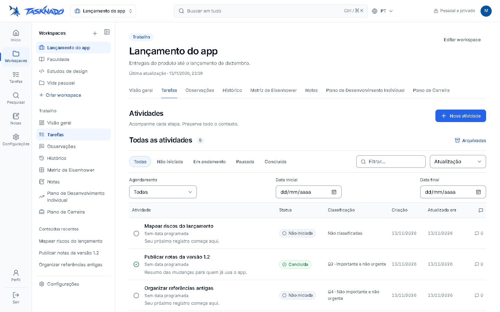 | 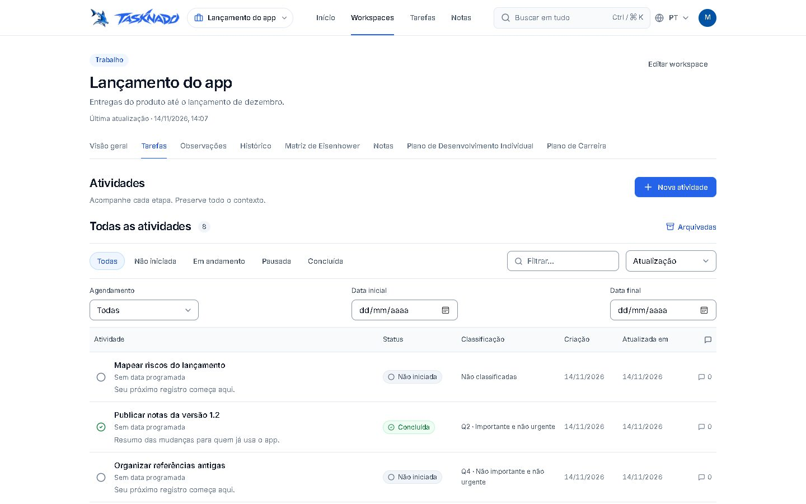 |
| Contexto do workspace | 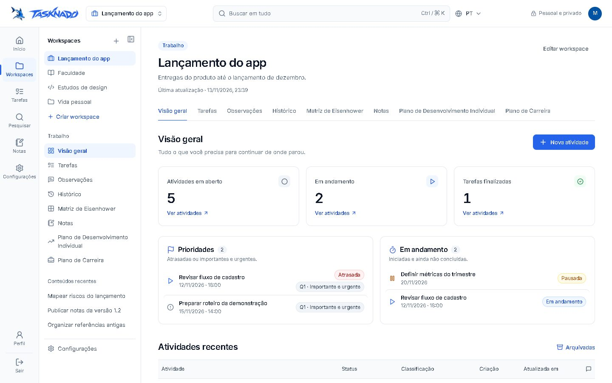 | 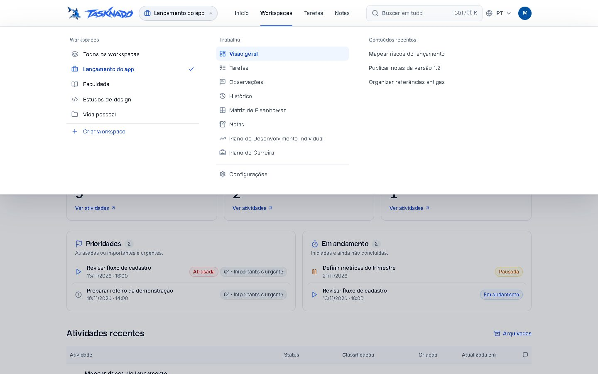 |
| 1024 px | 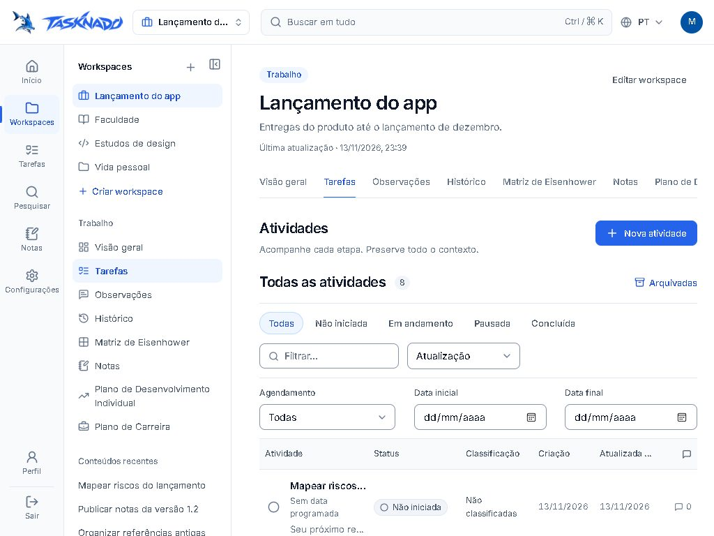 | 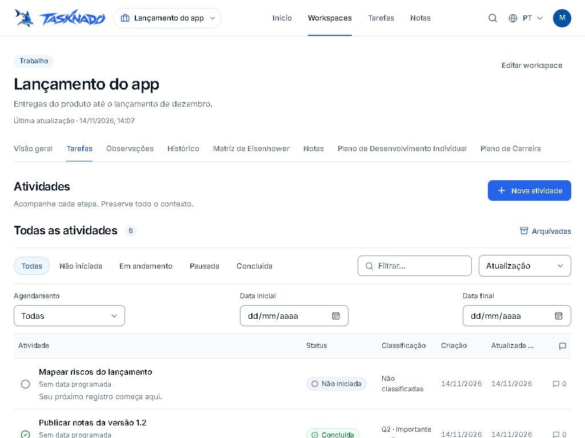 |
| Tablet 768 px | 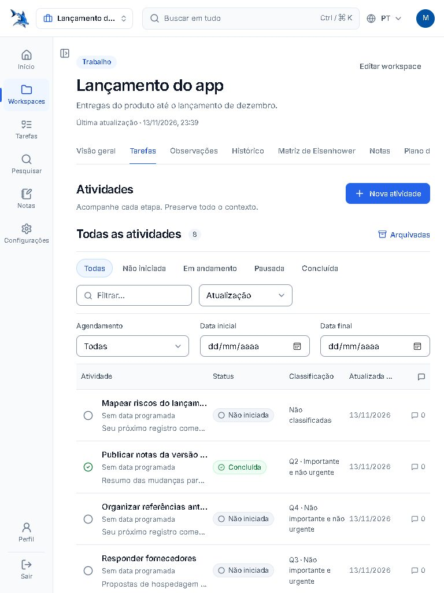 | 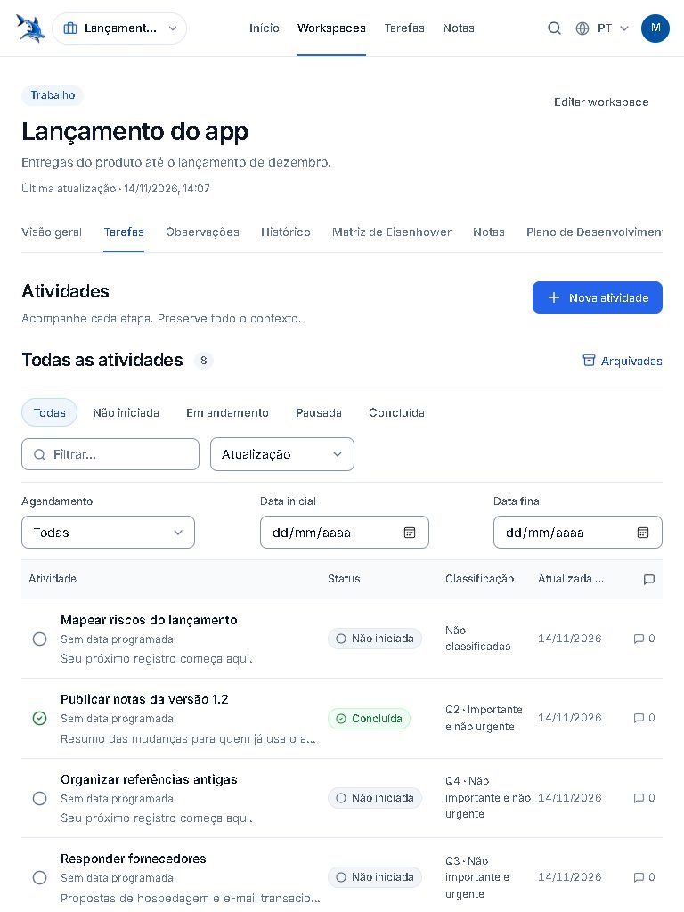 |
| Celular 375 px | 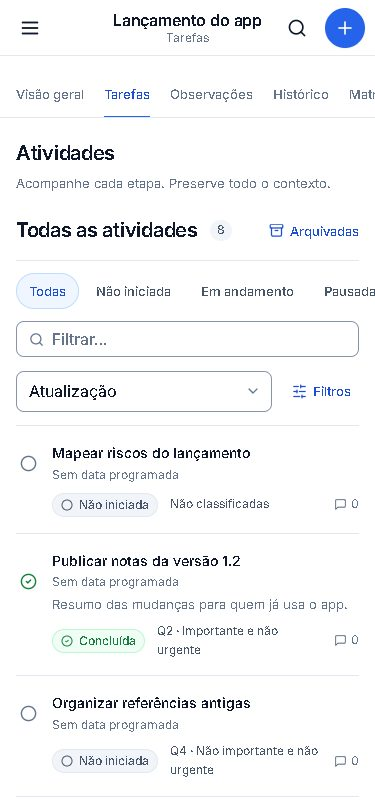 | 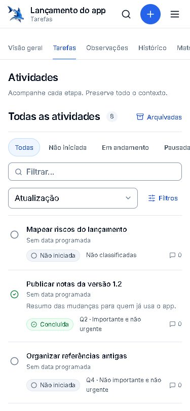 |
| Drawer do celular | 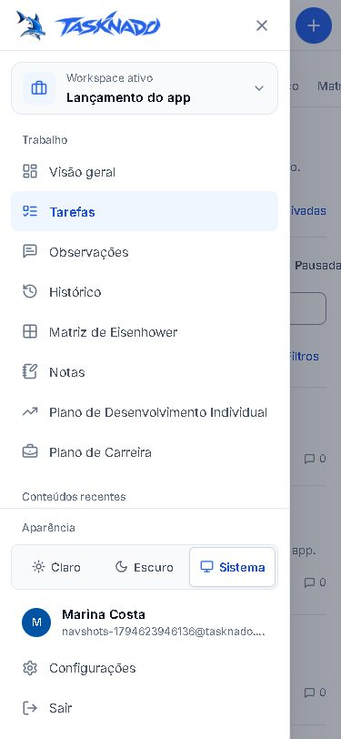 | 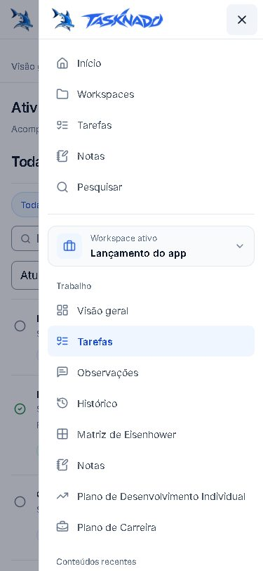 |
| Tema escuro | 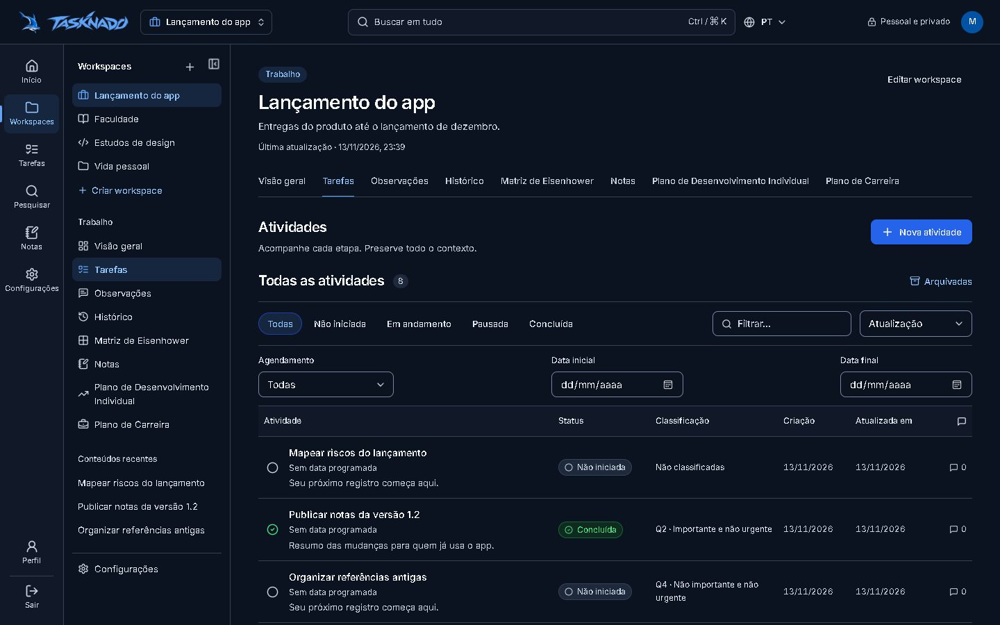 | 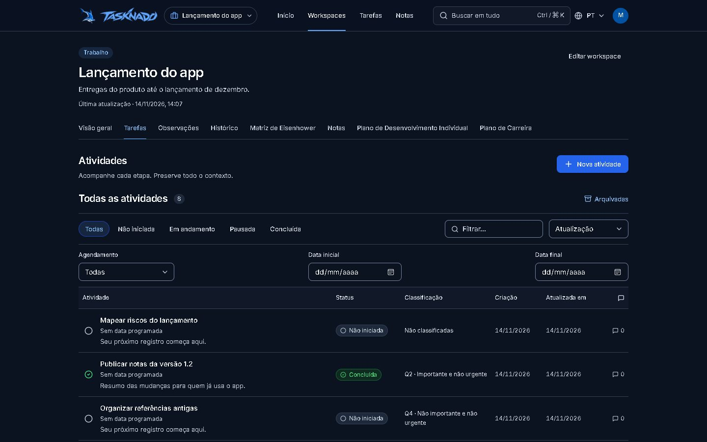 |
